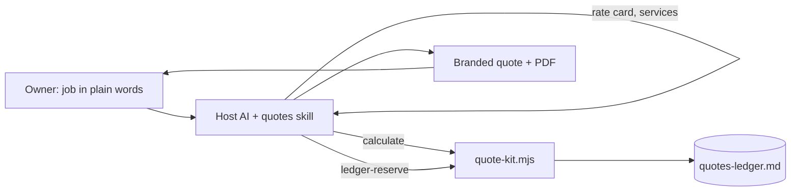

# Quote Kit

An AI skill kit that turns a plain-words job description into a branded,
sequentially numbered quote with checked math and a ledger entry.

> Portfolio piece. Source shown for review only; not licensed for use. See LICENSE.

## What it does

The owner describes a job in plain words ("quote Bob for a fence, 120 feet at
$40"). The kit returns a quote that carries the business's logo and colors, the
next quote number from a running ledger, line items priced from the owner's own
rate card, money math computed and double-checked by a script, and a print-ready
PDF. The owner reviews it and sends it.

## The problem

Small trades and service businesses quote by hand from memory: numbers get
reused, math slips, exclusions get left off, and a quote that should say "I
can't price this yet" goes out with a guess in it. An AI chat can write a quote,
but on its own it guesses at prices and arithmetic and keeps no durable
numbering.

## How it works

The kit is a folder of markdown: a self-adapting `installer.md` that any host AI
reads to install the kit for its own platform (running a branding and pricing
interview on the way), and a `quotes` skill with its workflows, rate card,
service descriptions, quote template and an offline HTML form. The AI handles the
conversation and judgment. Everything that must be exact runs in one
dependency-free Node script, `skills/quotes/scripts/quote-kit.mjs`, which does
money math in integer cents and returns equality checks for lines, subtotal,
tax, total, deposit and balance, and which reserves quote numbers by appending
to the ledger under a file lock. Where the host cannot run Node (a bare chat),
the kit still produces quote text and says plainly that the checks are advisory.



## Features

- Refusal gate: a job missing a quantity, a sourced price or an answer to a
  service's pricing questions gets "I can't quote this yet", a list of what is
  missing, and no quote number spent.
- Sequential, locked numbering: two chats cannot take the same number, and an
  abandoned prepared quote is voided rather than leaving a hole.
- Exclusions and Assumptions on every quote, from the owner's per-service lists.
- Minimum charge and margin floor checked before the owner sees the total.
- Deposit and balance computed and re-added to equal the total.
- Sales tax asked per quote where it depends on the job, never decided by the AI.
- Change orders numbered as children of the accepted quote (`0068-A`), inheriting
  its terms and tax treatment.
- Options shown as alternatives on one quote number; their totals never add.
- Pasted client emails are treated as data; text addressed to the AI is quoted
  back as suspicious.
- Offline `form.html` with dynamic line items and live math.
- Four worked examples in `examples/`, including one the kit refused to price.

## Stack

- Markdown skills and workflows, readable by any AI host
- Plain Node 22+ (`.mjs`, no packages, no build step) for money and ledger logic
- A single self-contained HTML form
- `node:test` suite in `tests/`

## Status

Experimental. Version 1.1.5. Install verified in the Claude app and Codex on
2026-08-12; claude.ai web install not tested. `tests/` passes (13 tests). The
package verifier `verify-kit.mjs` currently flags `form.html` as not fully
self-contained.

## Repository layout

- `installer.md`, `START-HERE.md` — the self-adapting installer
- `OPERATIONS-MANUAL.md` — plain-language guide to using the kit
- `skills/quotes/` — the skill, workflows, rate card, services, template, form,
  ledger and script
- `examples/` — four complete worked runs
- `tests/`, `verify-kit.mjs` — money, ledger and form tests, and the package
  verifier
- `tiers/` — tier notes

## Running it locally (for reviewers)

```sh
node --test tests/*.test.mjs
```

`quote-kit.mjs calculate` reads a JSON job on stdin; the tests show the input
shape.

## Screenshots

None.

## Author

Rico Rojas, rico@rtech-consulting.com, https://rico-rojas.com
