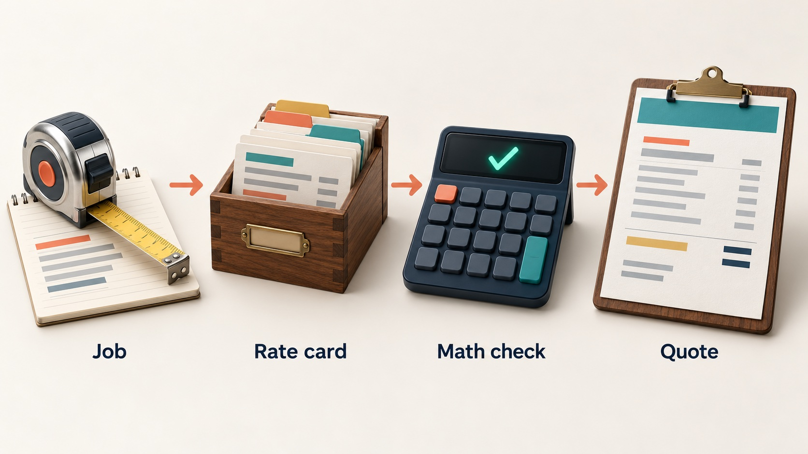
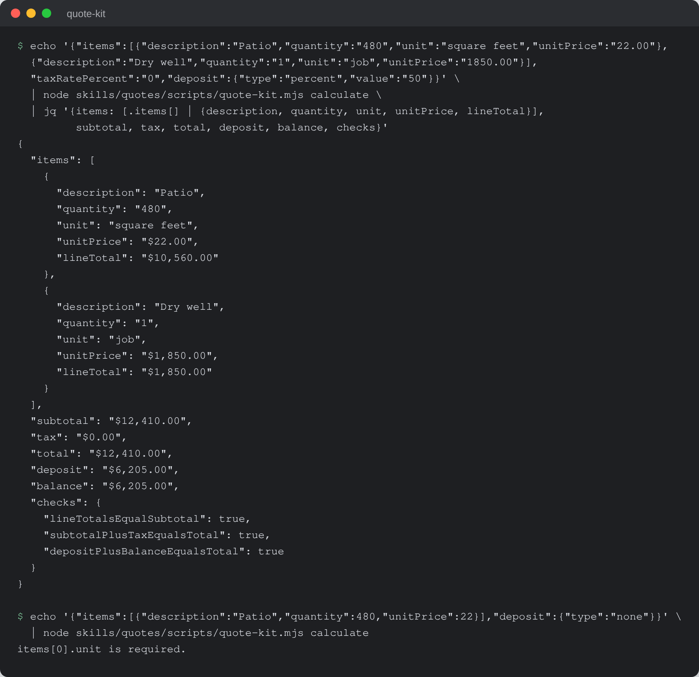

# Quote Kit

Turn a plain-words job description into a branded, sequentially numbered quote
whose money math is checked by a script, not guessed by the AI.


-f7df1e)


## What it is

An AI skill kit for small trades and service businesses. The owner describes a
job in plain words ("quote Bob for a fence, 120 feet at $40") or fills in the
offline form. The kit returns a quote that carries the business's logo and
colours, the next quote number from a running ledger, line items priced from
the owner's own rate card, money math computed and double-checked by a script,
and a print-ready page the owner saves as PDF. The owner reviews it and sends
it.

## Why it exists

Small businesses often quote by hand from memory: quote numbers get reused,
arithmetic slips, exclusions get left off, and a quote that should say "I can't
price this yet" goes out with a guess in it. An AI chat can write a quote, but
on its own it guesses at prices and arithmetic and keeps no durable numbering.
This kit lets the owner produce a correct, consistent quote in minutes and keep
their judgment on price and scope.

## How it works



`installer.md` is a self-adapting installer: the host AI reads it, runs a short
branding and pricing interview, and installs the `quotes` skill for its
platform. The skill holds the rate card, per-service descriptions, the quote
template, the offline form and four workflows (new quote, change order, ledger
update, render quote). The AI handles the conversation and the judgment.
Everything that must be exact runs in one dependency-free Node script,
`skills/quotes/scripts/quote-kit.mjs`: it does money math in integer cents,
returns equality checks for lines, subtotal, tax, total, deposit and balance,
and reserves quote numbers by appending to the ledger under a file lock. Where
the host cannot run Node (a bare chat), the kit still writes the quote and says
plainly that the checks are advisory.

## Features

- Refusal gate: a job missing a quantity, a sourced price or an answer to a
  service's pricing questions gets "I can't quote this yet", a list of what is
  missing, and no quote number spent.
- Sequential, locked numbering: two chats cannot take the same number, and an
  abandoned prepared quote is voided rather than leaving a gap.
- Exclusions and Assumptions on every quote, from the owner's per-service lists.
- Minimum charge and margin floor checked before the owner sees the total.
- Deposit and balance computed and re-added to equal the total.
- Sales tax asked per quote where it depends on the job, never decided by the
  AI.
- Change orders numbered as children of the accepted quote (`0068-A`),
  inheriting its terms and tax treatment.
- Options shown as alternatives on one quote number; their totals never add.
- Pasted client emails are treated as data; text addressed to the AI is quoted
  back as suspicious.
- Offline `form.html` with dynamic line items and live math.
- Four worked examples in `examples/`, including one the kit refused to price.

## Run it locally (for review)

Requires Node 22 or newer. No packages, no build step.

```sh
git clone https://github.com/rodaddy/quote-kit.git
cd quote-kit

# Money, ledger and form tests
node --test tests/*.test.mjs

# Price a two-line job; the script prints totals and its own equality checks
echo '{"items":[{"description":"Patio","quantity":"480","unit":"square feet","unitPrice":"22.00"},
  {"description":"Dry well","quantity":"1","unit":"job","unitPrice":"1850.00"}],
  "taxRatePercent":"0","deposit":{"type":"percent","value":"50"}}' \
  | node skills/quotes/scripts/quote-kit.mjs calculate

# The intake form opens offline in any browser
open skills/quotes/templates/quote/form.html
```



*`quote-kit.mjs calculate` on a two-line job (JSON trimmed by `jq` to the
customer-facing fields and the checks), then the same script refusing a line
item with no unit.*

The other subcommands (`ledger-next`, `ledger-reserve`, `ledger-reserve-change`,
`ledger-status`, `ledger-expire`, `ledger-migrate`, `ledger-unlock`) are listed
in `skills/quotes/scripts/README.md`. To use the kit itself, open
`START-HERE.md` in your AI assistant and follow the installer.

**Licence:** free for personal and non-commercial use with credit; commercial
use needs a licence. See [LICENSE](LICENSE) (PolyForm Noncommercial 1.0.0) or
contact rico@rtech-consulting.com.

## Repository layout

- `installer.md`, `START-HERE.md`: the self-adapting installer
- `OPERATIONS-MANUAL.md`: plain-language guide to using the kit
- `skills/quotes/`: the skill, workflows, rate card, services, template, form,
  ledger and script
- `examples/`: four complete worked runs
- `tests/`, `verify-kit.mjs`: money, ledger and form tests, and the package
  verifier
- `tiers/`: tier notes
- `docs/images/`: README images

## How it was built

Quote Kit started on 2026-07-15 as an AI skill that turned a job description
into a numbered quote. An internal review on 2026-08-11 found it never refused
a job it could not price. It was then reworked against three rounds of
simulated buyers, its money math moved into a tested script, and a review by a
second model family fixed three defects that could put a wrong quote in front
of a customer. The build story has the dates, the decisions and what did not
work: [docs/BUILD-STORY.md](docs/BUILD-STORY.md).

## Project status

Experimental. Version 1.1.5. The install has been checked in the Claude app and
in Codex; the claude.ai web install has not been tested. The test suite (13
tests) passes, and the package verifier `node verify-kit.mjs` passes.

## Credits

Built on plain Node.js (`node:test`, `node:fs`) with no third-party packages.

## Author

Rico Rojas, https://rico-rojas.com
